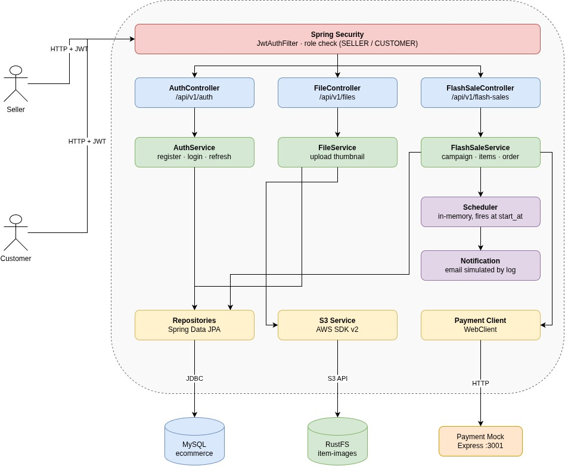
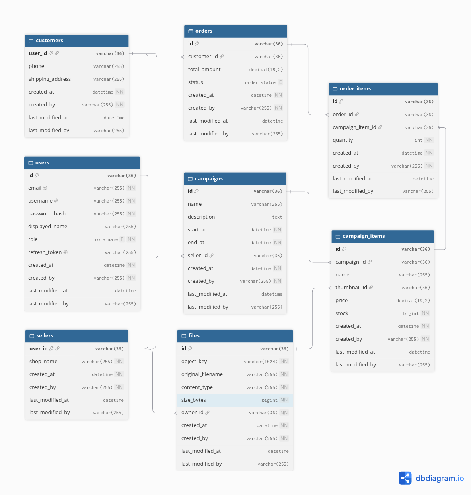

# Architecture Solution — Flash Sale

A small ecommerce backend built around **flash sale campaigns**: sellers create time-boxed campaigns with items and stock, customers order those items, and an external (mocked) payment gateway is called inside the order transaction.

## Table of contents

- [What it does](#what-it-does)
- [Architecture](#architecture)
- [Database](#database)
- [Tech stack](#tech-stack)
- [Getting started](#getting-started)
- [API reference](#api-reference)
- [Repository layout](#repository-layout)
- [Build, test and deploy](#build-test-and-deploy)
- [The nine intentional problems](#the-nine-intentional-problems)

## What it does

| Area | Capability |
| --- | --- |
| Accounts | Register as `SELLER` or `CUSTOMER`, log in, refresh tokens. JWT access tokens (5 min) + rotating refresh tokens (7 days). Passwords are BCrypt hashed. |
| Images | Sellers upload JPEG/PNG thumbnails. Binary goes to an S3-compatible store (RustFS), metadata goes to MySQL. |
| Campaigns | Sellers create a campaign (name, description, start/end time) with one or more items (name, price, stock, optional thumbnail). |
| Campaign Items | Anyone can list the items of a campaign. |
| Orders | Customers order items. The service checks stock, computes the total from stored prices, deducts stock, persists a `PENDING` order and calls the payment gateway, all in one database transaction. A payment exception rolls back database changes; it cannot reverse a completed external payment. |
| Notifications | When a campaign is created, an in-memory task is scheduled for its `start_at`. When it fires, a "Flash Sale is starting now!" email is *simulated* in the logs for every user. |
| Operations | Swagger UI, OpenAPI JSON and an Actuator health endpoint. |
## Architecture



The runtime consists of one Spring Boot process and three backing services:

| Component | Role |
| --- | --- |
| **Spring Boot monolith** (`:8080`) | REST API, security, business logic, scheduling. |
| **MySQL 8.4** | Single database `ecommerce`. Schema is created by `infrastructure/database/init/01-schema.sql`; Hibernate only *validates* it (`ddl-auto: validate`). |
| **RustFS** (`:9000`, console `:9001`) | S3-compatible object storage. Bucket `item-images` is created automatically at startup. |
| **Payment mock** (`:3001`) | Standalone Express app in `payment-mock/`. Simulates a payment provider; keeps payments in memory. |

Inside the monolith, requests flow through classic layers:

1. **Security** — `JwtAuthFilter` reads the `Authorization: Bearer …` header, validates the HS256 token, loads the user and sets `ROLE_SELLER` / `ROLE_CUSTOMER`. `SecurityConfig` whitelists the public routes; controllers use `@PreAuthorize` for role checks.
2. **Controllers** (`controller/`) — thin REST endpoints. Their OpenAPI annotations live in `controller/docs/*Api` interfaces.
3. **Services** (`service/`) — business rules: `AuthService`, `FileService`, `FlashSaleService`, `SchedulerService`, `NotificationService`, `EmailService`.
4. **Adapters** — Spring Data JPA repositories (`repository/`), the S3 services (`infrastructure/s3/`) and the `PaymentClient` (`client/payment/`, a `WebClient` with a 5 s timeout).
5. **Cross-cutting** — `GlobalExceptionHandler` turns exceptions into a uniform `ErrorResponse`; JPA auditing fills `created_by` / `last_modified_by` from the security context; Bean Validation guards the request DTOs.
## Database



Eight tables, all with UUID string primary keys and the audit columns `created_at`, `created_by`, `last_modified_at`, `last_modified_by` inherited from `BaseEntity`:

| Table | Purpose | Key relations |
| --- | --- | --- |
| `users` | Credentials, single `role`, latest `refresh_token` | — |
| `customers` | Customer profile (phone, shipping address) | PK = `users.id` |
| `sellers` | Seller profile (shop name) | PK = `users.id` |
| `files` | Image metadata and S3 `object_key` | `owner_id → sellers` |
| `campaigns` | Flash sale event with `start_at` / `end_at` | `seller_id → sellers` |
| `campaign_items` | Items for sale: name, price, stock, thumbnail | `campaign_id → campaigns`, `thumbnail_id → files` |
| `orders` | Customer order with `total_amount` and `status` | `customer_id → customers` |
| `order_items` | Items and quantities of an order | `order_id → orders`, `campaign_item_id → campaign_items` |
## Tech stack

| Concern | Choice |
| --- | --- |
| Framework | Spring Boot 4.1.1 (Web MVC, Security, Data JPA, Validation, Actuator, WebFlux client) |
| Persistence | Hibernate + MySQL 8.4|
| Auth | JJWT 0.11.5, BCrypt |
| Object storage | AWS SDK for Java v2 (`s3`) against RustFS |
| API docs | springdoc-openapi 3.1.0 |
| Payment mock | Node.js ≥ 18, Express 5 |
| Build / packaging | Maven Wrapper, Docker, Docker Compose v2 |
| CI | GitHub Actions builds, pushes and signs the image to GHCR on `main` |
## Getting started

### Prerequisites

- JDK 17
- Docker with Compose v2
- Node.js 18+ and npm (payment mock)
- `openssl` (to generate a JWT key)

Run all commands from the repository root unless stated otherwise.

### 1. Create the environment file

`deploy/env/.env` is git-ignored and holds the local configuration, including secrets. Create it from the template:

```bash
cp deploy/env/.env.example deploy/env/.env
```

Then fill it in. A working local set of values:

```dotenv
RUSTFS_ACCESS_KEY=rustfsadmin
RUSTFS_SECRET_KEY=rustfsadmin
RUSTFS_REGION=us-east-1
RUSTFS_ENDPOINT=http://localhost:9000

SPRING_DATASOURCE_URL=jdbc:mysql://localhost:3306/ecommerce
MYSQL_ROOT_PASSWORD=rootpassword
SPRING_DATASOURCE_USERNAME=root
SPRING_DATASOURCE_PASSWORD=rootpassword

JWT_SECRET_KEY='replace-with-a-generated-base64-key'
PAYMENT_GATEWAY_URL=http://localhost:3001
```

Generate a JWT key and paste it into `JWT_SECRET_KEY` in the env file:

```bash
openssl rand -base64 32
```

### 2. Start MySQL and RustFS

```bash
bash deploy/script/infra.sh
```

The script creates the Docker network `architecture_solution` if needed and starts both containers from `deploy/compose/compose-infra.yaml`. On the **first** start MySQL runs `01-schema.sql` and `02-fake-init.sql`; an existing data volume keeps its data and does not rerun them.

### 3. Start the payment mock

In a second terminal:

```bash
cd payment-mock
npm ci
npm start          # listens on :3001, override with PORT=...
```

### 4. Start the backend

Export the variables into the shell before starting Spring Boot:

```bash
set -a
source deploy/env/.env
set +a
./mvnw spring-boot:run
```

MySQL and RustFS must be reachable at startup (schema validation and bucket creation happen immediately).

### 5. Verify

| Service | URL |
| --- | --- |
| Backend health | http://localhost:8080/actuator/health |
| Swagger UI | http://localhost:8080/swagger-ui/index.html |
| OpenAPI JSON | http://localhost:8080/v3/api-docs |
| Payment mock health | http://localhost:3001/health |
| RustFS console | http://localhost:9001 |
| MySQL | `localhost:3306`, database `ecommerce` |

## API reference

| Method | Endpoint | Access | Description |
| --- | --- | --- | --- |
| POST | `/api/v1/auth/register` | Public | Register a `SELLER` (needs `shop_name`) or `CUSTOMER` (optional `phone`, `shipping_address`) |
| POST | `/api/v1/auth/login` | Public | Returns access + refresh token |
| POST | `/api/v1/auth/refresh` | Public (valid refresh token) | Rotates tokens |
| POST | `/api/v1/files/item-images` | `SELLER` | Multipart field `file`; JPEG/PNG only |
| POST | `/api/v1/flash-sales/campaign/create` | `SELLER` | Create a campaign with items |
| GET | `/api/v1/flash-sales/campaign/{campaignId}/items` | Public | List items of a campaign |
| POST | `/api/v1/flash-sales/campaign/order` | `CUSTOMER` | Create an order and charge it; campaign must be active |
| GET | `/actuator/health` | Public | Liveness |
| GET | `/swagger-ui/index.html`, `/v3/api-docs` | Public | API documentation |

Request and response JSON use `snake_case`. Validation rules worth knowing:

- Register: all of `email` (valid address), `username` (≤ 50 chars), `password`, `retype_password`, `role` are required; `phone` must be 9–15 digits.
- Campaign: `name`, `start_at < end_at`, non-empty `items`; each item needs `name`, `price > 0`, `stock > 0`, and an optional `thumbnail_id` that belongs to the seller.
- Order: non-empty `items`; each needs `campaign_item_id` and `quantity > 0`.

Order creation is **not idempotent**: the endpoint does not read `Idempotency-Key` or store a deduplication record. Double-clicking checkout or retrying after a lost response can create another order, deduct stock again and request another payment. Sending that header alone provides no protection. See problem 9 in [The nine intentional problems](#the-nine-intentional-problems).

### Response envelopes

Success:

```json
{
  "status_code": <http status code>,
  "message": "<human readable message>",
  "data": <payload: object, array or null>
}
```

Error:

```json
{
  "status_code": <http status code>,
  "error": "<http reason phrase>",
  "message": "<what went wrong>",
  "path": "<request path>",
  "timestamp": "<ISO 8601 instant>"
}
```

| HTTP | When |
| --- | --- |
| 400 | Validation error, passwords do not match, out of stock, invalid image, `end_at` before `start_at`, campaign not active |
| 401 | Missing/invalid/expired token, wrong credentials, invalid refresh token |
| 403 | Authenticated but wrong role, or seller profile missing |
| 404 | Campaign, campaign item or thumbnail not found |
| 409 | Username/email already exists, or a database constraint failed |
| 500 | Storage failure or unexpected server state |
| 502 | Payment gateway error, timeout or unreachable |

### Payment mock

| Method | Endpoint | Description |
| --- | --- | --- |
| GET | `/health` | Health check |
| POST | `/payments` | Simulate a payment for a customer (`customer_id`, `total_amount`); header `Fault: true` forces a failure |

## Repository layout

```text
.
├── src/main/java/com/architecture/solution/
│   ├── annotation/          # @ValueOfEnum validator
│   ├── client/payment/      # PaymentClient (WebClient) + DTOs
│   ├── config/              # Security, WebClient, auditing, scheduler beans
│   ├── controller/          # REST controllers; docs/ holds OpenAPI interfaces
│   ├── dto/                 # Request / response models (snake_case JSON)
│   ├── entity/              # JPA entities (BaseEntity holds audit columns)
│   ├── enums/               # RoleName, OrderStatus, TokenType, ...
│   ├── exception/           # Custom exceptions + GlobalExceptionHandler
│   ├── filter/              # JwtAuthFilter
│   ├── infrastructure/s3/   # S3 client config, bucket/object services, initializer
│   ├── repository/          # Spring Data JPA repositories
│   ├── security/            # UserDetails, 401/403 handlers
│   ├── service/             # Service interfaces and impl/
│   └── util/                # JwtUtils, FileUtils, SecurityUtils, ErrorResponseUtils
├── src/main/resources/
│   └── application.yaml         # tracked: defaults and environment placeholders
├── src/test/                    # Spring context smoke test
├── infrastructure/database/init/
│   ├── 01-schema.sql            # database, tables, foreign keys
│   └── 02-fake-init.sql         # demo users and campaign
├── payment-mock/                # Express payment simulator
├── deploy/
│   ├── compose/                 # compose-infra.yaml (MySQL + RustFS), compose-app.yaml
│   ├── env/                     # .env.example (tracked), .env (not tracked)
│   └── script/                  # infra.sh, deploy.sh
├── docs/                        # architecture.drawio, database.dbml, exported images
├── Dockerfile
└── .github/workflows/docker-publish.yml
```

## Build, test and deploy

### Tests

```bash
./mvnw test
```

The suite is a single Spring context smoke test, so it needs the same configuration and running MySQL/RustFS as the application. The payment mock has an `npm test` script but no tests yet.

### Jar

```bash
./mvnw clean package -DskipTests
java -jar target/solution-0.0.1-SNAPSHOT.jar      # same exported env as spring-boot:run
```

### Docker image

```bash
docker build -t architecture-solution:local .
```

Multi-stage build (`maven:3.9.9-eclipse-temurin-17` → `eclipse-temurin:17-jre-alpine`), runs as a non-root user with `-Xms256m -Xmx512m`.

### Docker Compose deployment

```bash
bash deploy/script/deploy.sh
```

Starts the infrastructure, waits for health checks, then runs `deploy/compose/compose-app.yaml`, which pulls `ghcr.io/binhphuc/architecturesolution:latest` (it does not build the local checkout). Both scripts use `deploy/env/.env`. When the backend runs in a container:

- use `jdbc:mysql://mysql:3306/ecommerce` and `http://rustfs:9000` (containers share the `architecture_solution` network);
- point `PAYMENT_GATEWAY_URL` at an address reachable from the container (`localhost:3001` would be the container itself; the mock is not part of the Compose files);
- fill in all required variables from `.env.example`, including `JWT_SECRET_KEY`; Compose passes them into the container and `application.yaml` resolves its placeholders.

GitHub Actions (`.github/workflows/docker-publish.yml`) builds the image on every push to `main`, pushes it to GHCR and signs it with cosign. Manual runs can opt in to pushing. The workflow does not deploy the application and does not need application secrets; configuration is supplied when the container runs.
## The nine intentional problems

| # | Problem | Where it lives today | What goes wrong |
| --- | --- | --- | --- |
| 1 | **Race condition / overselling** | `FlashSaleServiceImpl.createOrder`: `findById` → `stock < quantity` → `setStock(stock - quantity)` inside a plain `@Transactional`| Two customers buy the last item at the same time: both see stock = 1, both pass the check, both succeed. The shop sells more than it has. |
| 2 | **Third-party API bottleneck** | `PaymentClientImpl.processPayment` is a blocking `WebClient … .block()` call with a 5 s timeout, executed on the request thread | Every order waits for the payment provider. If it is slow or down, every order is slow or fails, and the whole app can stop serving requests. |
| 3 | **Notification burst** | `SchedulerServiceImpl`: when a campaign starts it loads **all** users and sends a notification to each one in a loop, in one thread | When a campaign starts, the app tries to notify every user at the same moment. With many users this overloads the app and the email/push provider. |
| 4 | **Scheduled task conflicts under horizontal scaling** | `SchedulerConfig` uses `SimpleAsyncTaskScheduler`, which keeps its tasks in the JVM memory, so every instance has its own separate scheduler | The scheduled task lives in the memory of one instance.<br>1. Restart that instance and the task is gone<br>2. Run several instances and the task may run several times |
| 5 | **Slow synchronous processing** | `createOrder` runs every step (stock check, DB writes, payment call) inside the HTTP request and only responds when all of them are done | The customer waits for the slowest step. Even with a fast payment provider, the response time grows with every step added, and nothing can be deferred to run later. |
| 6 | **Dual write** | 1. `createOrder` writes to MySQL and then calls the payment service in the same transaction<br>2. `FileServiceImpl.uploadItemImage` writes to RustFS then to MySQL | Two systems are written in one step with no way to undo both.<br>1. Money can be taken while the order is rolled back<br>2. A file can be stored while its database row fails<br> |
| 7 | **Tight coupling** | `NotificationServiceImpl` is hard-wired to one channel: it injects `EmailService` and calls it directly | Adding another channel (for example `SmsService`) means editing `NotificationServiceImpl` instead of plugging a new sender in. Every new channel changes existing code. |
| 8 | **No cache** | 1. `getItemsByCampaignId` and the per-item lookups in `createOrder` hit MySQL on every call<br>2. Nothing is cached (no Redis, no Spring Cache) | Every request reads the same campaign data from MySQL again. During a flash sale thousands of identical reads hit the database at once. |
| 9 | **No idempotency** | `createOrder` has no idempotency key or duplicate-request check<br> | A double-click or retry can create duplicate orders, deduct stock again and charge the customer more than once. |
