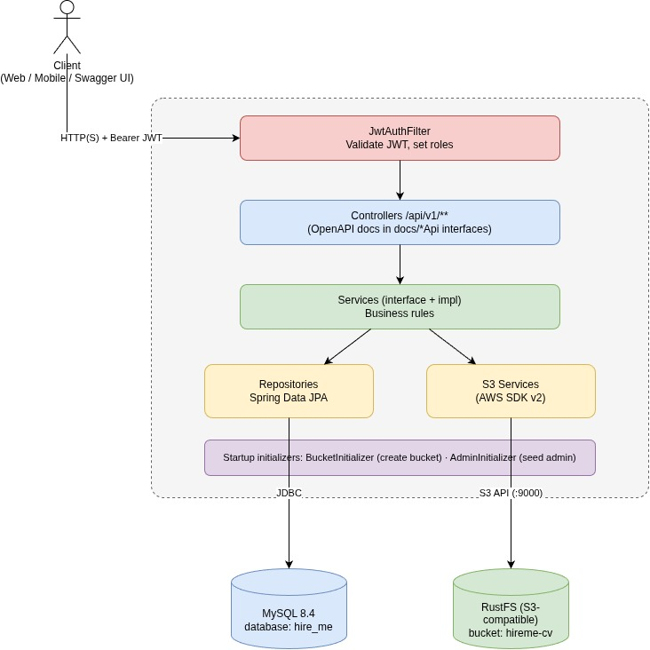
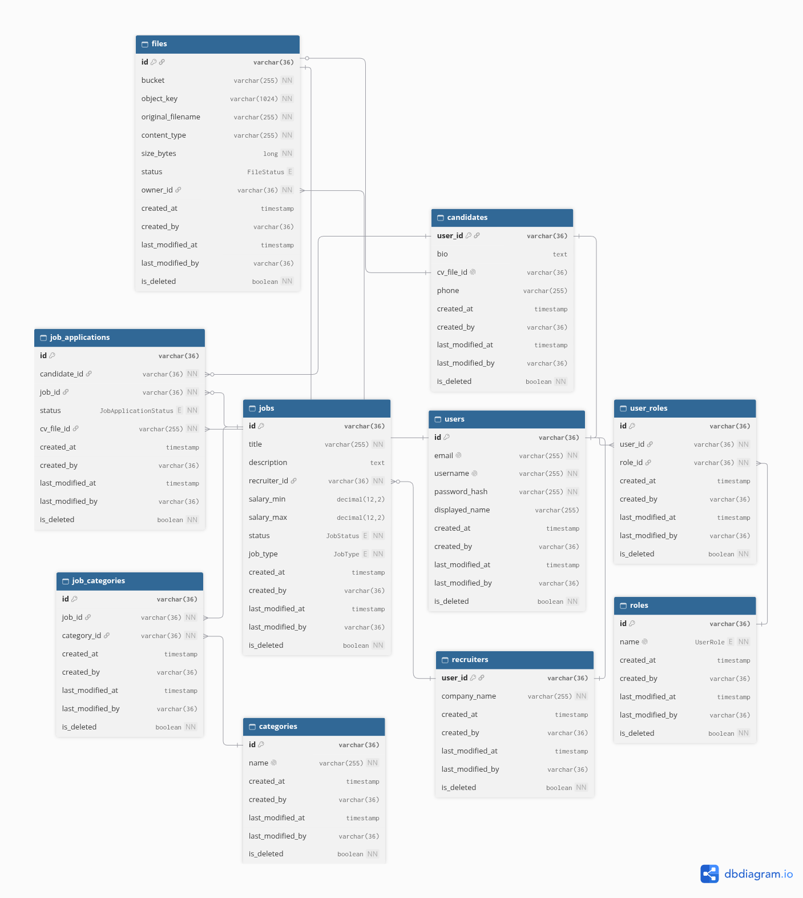

# HireMe — Job Board REST API

HireMe is a backend service for a job marketplace. **Recruiters** publish job postings, **candidates** browse them and apply with a PDF CV, and recruiters review the applications they receive.

## Table of Contents

- [Features](#features)
- [Tech Stack](#tech-stack)
- [Architecture](#architecture)
- [Getting Started](#getting-started)
- [Configuration](#configuration)
- [API Overview](#api-overview)
- [Data Model](#data-model)
- [Deployment](#deployment)
- [Project Structure](#project-structure)

## Features

| Role          | Capabilities                                                                                      |
|---------------|---------------------------------------------------------------------------------------------------|
| **Anyone**    | Register, log in, refresh tokens; search jobs; view a job, its categories and a recruiter profile |
| **Candidate** | Manage profile and CV; apply to open jobs by uploading a PDF; track own applications              |
| **Recruiter** | Create, update, close and delete own jobs; list and inspect applications for own jobs             |
| **Admin**     | Seeded automatically on first start (see [Configuration](#configuration))                         |

Highlights:

- Stateless JWT authentication (short-lived access token + rotating refresh token) with role-based authorization (`ADMIN`, `RECRUITER`, `CANDIDATE`).
- CVs are validated as readable PDFs and stored in S3-compatible object storage; only metadata lives in the database.
- Soft deletes and audit fields on every table.
- Uniform response envelope and centralized error handling.
- Interactive API documentation via Swagger UI.

## Tech Stack

- **Language / Framework:** Java 17, Spring Boot 4.1
- **Database:** MySQL 8.4
- **Object storage:** [RustFS](https://github.com/rustfs/rustfs) (S3-compatible)
- **Auth:** JWT (jjwt 0.11.5), BCrypt password hashing
- **PDF validation:** Apache PDFBox
- **API docs:** springdoc-openapi
- **Build / delivery:** Maven, Docker, Docker Compose, GitHub Actions

## Architecture



A classic layered design: controllers handle HTTP and OpenAPI annotations (kept in separate `docs/*Api` interfaces), services hold business rules, repositories use Spring Data JPA. On startup, `BucketInitializer` creates the CV bucket and `AdminInitializer` seeds a default admin if none exists.

## Getting Started

### Prerequisites

- JDK 17+
- Docker and Docker Compose
- Maven

### 1. Start the infrastructure

Create `deploy/env/.env.dev` from the template and fill in the values:

```bash
cp deploy/env/.env.example deploy/env/.env.dev
```

Then start MySQL and RustFS:

```bash
./deploy/script/infra.sh
```

This creates the `architecture_solution` Docker network and brings up:

| Service | Ports                             | Notes                                                                            |
|---------|-----------------------------------|----------------------------------------------------------------------------------|
| MySQL   | `3306`                            | Schema and roles are created from `infrastructure/database/init/` on first start |
| RustFS  | `9000` (S3 API), `9001` (console) | Credentials from `RUSTFS_ACCESS_KEY` / `RUSTFS_SECRET_KEY`                       |

The init scripts also load **development fixtures** (`03-fake-init.sql`): `admin` / `Admin@123`, `recruiter01..03` and `candidate01..08` / `Demo@123`. Do not use this script in production.

### 2. Configure the application

Create `src/main/resources/application-dev.yaml` with the properties listed in [Configuration](#configuration).

### 3. Run

```bash
./mvnw spring-boot:run
```

The API is served at `http://localhost:8080`.

- Swagger UI: `http://localhost:8080/swagger-ui.html`
- Health check: `http://localhost:8080/actuator/health`

### Build and test

```bash
./mvnw clean verify      # compile and run tests
./mvnw package -DskipTests
```

## Configuration

Settings are resolved from `application.yaml` plus the active profile (`SPRING_PROFILES_ACTIVE`, default `dev`). Locally, put these settings in the git-ignored `application-dev.yaml`, which reads them from the environment variables in the **Env var** column.

| Property                                                       | Env var                                                       | Description                                                                             |
|----------------------------------------------------------------|---------------------------------------------------------------|-----------------------------------------------------------------------------------------|
| `spring.datasource.url` / `username` / `password`              | `SPRING_DATASOURCE_URL` / `_USERNAME` / `_PASSWORD`           | MySQL connection (database `hire_me`)                                                   |
| `jwt.secretKey`                                                | `JWT_SECRET_KEY`                                              | **Base64-encoded** HMAC-SHA256 signing key (at least 256 bits)                          |
| `s3.endpoint` / `access-key` / `secret-key` / `region`         | `RUSTFS_ENDPOINT` / `_ACCESS_KEY` / `_SECRET_KEY` / `_REGION` | S3-compatible storage connection                                                        |
| `app.admin.email` / `username` / `password` / `displayed-name` | `ADMIN_EMAIL` / `_USERNAME` / `_PASSWORD` / `_DISPLAYED_NAME` | Default admin created at startup if no admin exists. Skipped when the password is empty |

Fixed defaults: access token lifetime 5 minutes, refresh token lifetime 7 days, upload limits 10 MB per file / 15 MB per request, CV bucket `hireme-cv`.

> **Security:** never commit real secrets. `application-dev.yaml` and `deploy/env/.env.dev` are git-ignored. Note that `spring.jpa.hibernate.ddl-auto` is `update` by default. Consider `validate` in production and manage the schema through the SQL scripts.

## API Overview

Base path: `/api/v1`. Full request/response schemas are available in Swagger UI.

**Auth** — public

| Method | Path             | Description                             |
|--------|------------------|-----------------------------------------|
| POST   | `/auth/register` | Register a user with one or more roles  |
| POST   | `/auth/login`    | Obtain access and refresh tokens        |
| POST   | `/auth/refresh`  | Exchange a refresh token for new tokens |
| PUT    | `/auth/logout`   | Invalidate the refresh token            |

**Jobs**

| Method | Path                   | Access            | Description                                                        |
|--------|------------------------|-------------------|--------------------------------------------------------------------|
| GET    | `/jobs`                | Public            | Search by `title`, `jobType`, `status`; paginated (`page`, `size`) |
| GET    | `/jobs/{jobId}`        | Public            | Get one job                                                        |
| POST   | `/jobs`                | Recruiter         | Create a job (starts as `OPEN`)                                    |
| POST   | `/jobs/{jobId}`        | Recruiter (owner) | Partially update a job                                             |
| POST   | `/jobs/{jobId}/status` | Recruiter         | Change status (`OPEN`, `FILLED`, `CLOSED`)                         |
| DELETE | `/jobs/{jobId}`        | Recruiter         | Soft delete; `409` if it still has applications                    |

**Applications**

| Method | Path | Access | Description |
|--------|------|--------|-------------|
| POST | `/jobs/{jobId}/application` | Candidate | Apply to an open job with a PDF CV (multipart); one application per job |
| GET | `/jobs/{jobId}/applications` | Recruiter (owner) | List applications for a job |
| GET | `/applications/{applicationId}` | Recruiter (owner) | Application detail with candidate info |
| GET | `/applications/me/{applicationId}` | Candidate | Own application detail |
| GET | `/candidates/me/applications` | Candidate | List own applications |

**Users, profiles and files**

| Method | Path | Access | Description |
|--------|------|--------|-------------|
| GET / POST | `/users/me` | Authenticated | View / update own profile |
| POST | `/users/me/password` | Authenticated | Change password |
| POST | `/candidates/me` | Candidate | Update candidate profile |
| GET | `/recruiters/{recruiterId}` | Public | Public recruiter profile |
| GET / POST | `/recruiters/me` | Recruiter | View / update own recruiter profile |
| GET | `/categories` | Public | List job categories |
| POST | `/files/upload/cv` | Candidate | Upload a default CV (PDF) |

Authenticate protected requests with `Authorization: Bearer <access_token>`.

## Data Model



The full DDL is in [`infrastructure/database/init/01-schema.sql`](infrastructure/database/init/01-schema.sql).

## Deployment

1. **CI:** `.github/workflows/docker-publish.yml` builds the image on every push to `main`, pushes it to `ghcr.io/binhphuc/architecturesolution`, and signs it with cosign. It can also be triggered manually.
2. **Image:** a multi-stage `Dockerfile`, running as a non-root user.
3. **Run:** `./deploy/script/deploy.sh` starts the infrastructure, waits for it to be healthy, then pulls and starts the application container (`deploy/compose/compose-app.yaml`). The script reads `deploy/env/.env.dev`; edit `is_dev` in the script to use `deploy/env/.env` instead.

The whole env file is passed to the application container via `env_file`, so every variable listed in [`deploy/env/.env.example`](deploy/env/.env.example) (datasource, `JWT_SECRET_KEY`, `ADMIN_*`, `RUSTFS_*`) reaches the app. Note that `application-dev.yaml` is git-ignored and not part of the image, so a production profile that maps these variables to the properties in [Configuration](#configuration) is still to be added.
4. **Secrets (planned):** store them in GitHub Secrets and have the workflow generate `deploy/env/.env` at deploy time. Automated deployment is not set up yet.

## Project Structure

```

├── src/main/java/com/architecture/solution
│   ├── config/          Security, S3, auditing, startup initializers
│   ├── controller/      REST controllers (+ docs/ OpenAPI interfaces)
│   ├── service/         Business logic (interfaces + impl/)
│   ├── repository/      Spring Data JPA repositories and projections
│   ├── entity/          JPA entities (soft delete + audit base class)
│   ├── dto/             Request/response models, ApiResponse envelope
│   ├── security/        Auth entry point, access-denied handler, user details
│   ├── filter/          JWT authentication filter
│   ├── exception/       Domain exceptions and GlobalExceptionHandler
│   └── util/, validator/, annotation/, enums/, constant/
├── infrastructure/database/init/   Schema, role seed, dev fixtures
└── deploy/                         Compose files, env template, scripts
```
