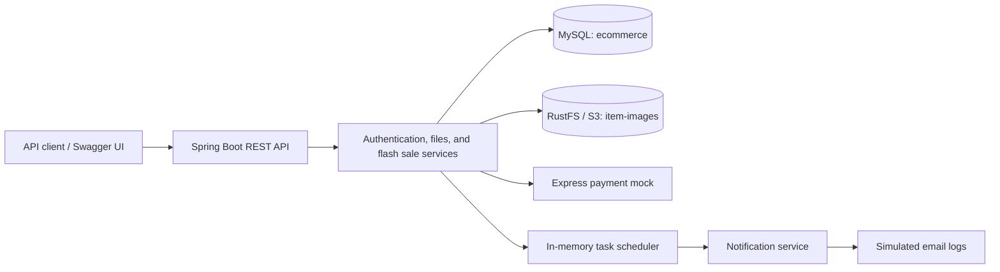

# Architecture Solution — Flash Sale

A Spring Boot backend for a flash sale ecommerce system. The application uses a monolithic architecture with one MySQL database, S3-compatible image storage through RustFS, and a separate Express service that simulates payment processing.

## Current features

- Register and authenticate users with `SELLER` or `CUSTOMER` roles.
- Issue JWT access tokens and refresh tokens; store passwords with BCrypt.
- Upload JPEG/PNG item thumbnails to the `item-images` bucket.
- Create campaigns containing items with their own name, price, stock, and optional thumbnail.
- Retrieve campaign items without authentication.
- Create customer orders, calculate totals, update stock, and call the payment gateway within a database transaction.
- Schedule a notification when a newly created campaign starts. Email delivery is currently simulated through application logs.
- Expose Swagger/OpenAPI documentation and an Actuator health endpoint.

There is no separate product catalog: product information lives directly in `campaign_items`. The current roles are `SELLER` and `CUSTOMER`; there is no admin registration or admin initialization flow.

## Architecture



Controllers expose REST endpoints, services implement business logic, and Spring Data JPA repositories persist data. Spring Security applies JWT authentication and method-level role checks. `WebClient` handles payment requests; the application serves requests through Spring MVC.

## Technology

| Component | Configuration in this repository |
| --- | --- |
| Java | Source target 17; Docker build and runtime use Java 21 |
| Spring Boot | 4.1.1 |
| Persistence | Spring Data JPA / Hibernate, MySQL 8.4 |
| Security | Spring Security, JJWT 0.11.5, BCrypt |
| API documentation | springdoc-openapi 3.1.0 |
| Object storage | AWS SDK for Java v2, RustFS |
| Payment simulator | Node.js 18+, Express 5 |
| Build and deployment | Maven Wrapper, Docker Compose, GitHub Actions / GHCR |

## Repository layout

```text
src/main/java/com/architecture/solution/
├── client/payment/       # Payment gateway integration
├── config/               # Security, WebClient, auditing, scheduler
├── controller/           # REST endpoints and OpenAPI interfaces
├── dto/                  # Request and response models
├── entity/               # JPA entities
├── exception/            # Exceptions and centralized error handling
├── infrastructure/s3/    # S3 configuration, bucket and object services
├── repository/           # Spring Data JPA repositories
├── security/             # User details and security error handlers
├── service/              # Business services and implementations
└── util/                 # JWT, file validation, and security helpers
src/main/resources/application.yaml
src/test/                 # Spring application context smoke test
infrastructure/database/init/
├── 01-schema.sql          # Database, tables, and foreign keys
└── 02-fake-init.sql       # Development users and sample campaign
payment-mock/             # Standalone Express payment simulator
deploy/
├── compose/              # Infrastructure and application Compose files
├── env/                  # Environment template and local configuration
└── script/               # Infrastructure and deployment scripts
```

## Run locally

Run commands from the repository root unless a step specifies otherwise. Requirements: JDK 17+ (Java 21 matches the Dockerfile), Docker with Compose v2, Node.js 18+ with npm, and OpenSSL for generating a JWT key. Maven is provided by `mvnw` (`mvnw.cmd` on Windows); the shell examples below use Bash.

### 1. Configure the environment

Create `deploy/env/.env.dev` with the following development values, or adapt an existing file. This path is ignored by Git. Replace the example credentials for your environment.

```dotenv
SPRING_PROFILES_ACTIVE=dev
MYSQL_ROOT_PASSWORD=local-mysql-password
SPRING_DATASOURCE_URL=jdbc:mysql://localhost:3306/ecommerce
SPRING_DATASOURCE_USERNAME=root
SPRING_DATASOURCE_PASSWORD=local-mysql-password

RUSTFS_ACCESS_KEY=local-rustfs-access
RUSTFS_SECRET_KEY=local-rustfs-secret-password

S3_ACCESSKEY=local-rustfs-access
S3_SECRETKEY=local-rustfs-secret-password
S3_REGION=us-east-1
S3_ENDPOINT=http://localhost:9000

JWT_SECRETKEY=replace-with-generated-base64-key
PAYMENT_GATEWAY_URL=http://localhost:3001
PAYMENT_TIMEOUT=5s
```

Generate a Base64-encoded key and paste it into `JWT_SECRETKEY`:

```bash
openssl rand -base64 32
```

Configuration details:

- `RUSTFS_ACCESS_KEY` and `RUSTFS_SECRET_KEY` configure the RustFS container. The corresponding `S3_ACCESSKEY` and `S3_SECRETKEY` values configure the application and must match.
- The application reads `jwt.secretKey`; its direct environment variable is `JWT_SECRETKEY`. S3 properties are bound under `s3`, using the variables shown above.
- The checked-in [environment template](deploy/env/.env.example) contains older names such as `JWT_SECRET_KEY` and `RUSTFS_ENDPOINT`. Those require an explicit property mapping to configure JWT/S3. The example above works directly with the checked-in application configuration. The template's `ADMIN_*` entries are currently unused.
- The default profile is `dev`. An `application-dev.yaml` file is optional and is not tracked; the environment variables above are sufficient.
- Hibernate uses `ddl-auto: validate`, so the database schema must exist before application startup.

### 2. Start MySQL and RustFS

```bash
bash deploy/script/infra.sh
```

The script reads `deploy/env/.env.dev`, creates the external Docker network `architecture_solution` if necessary, and starts the infrastructure containers. Wait for both services to become healthy:

```bash
docker compose -p architecture-solution-infra \
  --env-file deploy/env/.env.dev \
  -f deploy/compose/compose-infra.yaml ps
```

MySQL runs the SQL files in `infrastructure/database/init` automatically when its data volume is first initialized. Existing volumes retain their data and do not rerun these scripts. For a separately managed, empty database, run `01-schema.sql` first and optionally `02-fake-init.sql`. These scripts initialize a database; they are not migrations for an existing schema.

### 3. Start the payment mock

In a separate terminal:

```bash
cd payment-mock
npm ci
npm start
```

The default port is `3001`; set `PORT` to override it. Payment records are held in memory and disappear on restart.

### 4. Start the backend

Export the environment file before launching Maven; Spring Boot does not automatically load this `.env` file:

```bash
set -a
source deploy/env/.env.dev
set +a
./mvnw spring-boot:run
```

MySQL and RustFS must be reachable at startup. The application initializes the `item-images` bucket if it does not exist.

| Service | Local address |
| --- | --- |
| Backend | http://localhost:8080 |
| Swagger UI | http://localhost:8080/swagger-ui/index.html |
| OpenAPI JSON | http://localhost:8080/v3/api-docs |
| Backend health | http://localhost:8080/actuator/health |
| MySQL | `localhost:3306`, database `ecommerce` |
| RustFS S3 endpoint | http://localhost:9000 |
| RustFS console | http://localhost:9001 |
| Payment mock health | http://localhost:3001/health |

## Database and development data

The schema contains eight tables:

| Table | Purpose |
| --- | --- |
| `users` | Credentials, role, display name, and stored refresh token |
| `customers` | Customer profile, phone, and shipping address; primary key is `users.id` |
| `sellers` | Seller profile and shop name; primary key is `users.id` |
| `files` | Image metadata, object key, and seller ownership |
| `campaigns` | Seller campaign with start and end timestamps |
| `campaign_items` | Campaign items, prices, stock, and thumbnail references |
| `orders` | Customer orders, totals, and status |
| `order_items` | Ordered campaign items and quantities |

The development seed creates `seller01` and `customer01`, plus a `Daily Flash Sale` campaign starting one day after seeding and lasting two hours. Its sample item is `Wireless Headphones`, priced at `700000`, with stock `20` and no thumbnail. Register a new account through the API if you need credentials you control.

Sample campaign ID: `00000000-0000-0000-0000-000000000030`. Sample item ID: `00000000-0000-0000-0000-000000000031`.

## REST API

Protected endpoints expect `Authorization: Bearer <access_token>`.

| Method | Endpoint | Access | Purpose |
| --- | --- | --- | --- |
| POST | `/api/v1/auth/register` | Public | Register a seller or customer |
| POST | `/api/v1/auth/login` | Public | Obtain access and refresh tokens |
| POST | `/api/v1/auth/refresh` | Public, valid refresh token required | Refresh tokens |
| POST | `/api/v1/files/item-images` | `SELLER` | Upload a thumbnail, multipart field `file` |
| POST | `/api/v1/flash-sales/campaign/create` | `SELLER` | Create a campaign and its items |
| GET | `/api/v1/flash-sales/campaign/{campaignId}/items` | Public | List campaign items |
| POST | `/api/v1/flash-sales/campaign/order` | `CUSTOMER` | Create an order and request payment |

### Authentication

Example seller registration body:

```json
{
  "email": "seller@example.com",
  "username": "my-seller",
  "password": "Demo@123",
  "retype_password": "Demo@123",
  "role": "SELLER",
  "shop_name": "My Shop"
}
```

For a customer, use `"role": "CUSTOMER"` and optionally provide `phone` (9–15 digits) and `shipping_address`. Seller registration requires `shop_name`. Display names are currently initialized from the username; `displayed_name` is not a registration request field.

Log in with `{"username":"my-seller","password":"Demo@123"}`. Tokens are returned in `data.access_token` and `data.refresh_token`. Access tokens last five minutes; refresh tokens initially last seven days. Refresh requests use `{"refresh_token":"<refresh_token>"}`. Refreshing preserves the original refresh-token expiry, and each user has one stored refresh token.

### Upload a thumbnail

```bash
curl -X POST http://localhost:8080/api/v1/files/item-images \
  -H "Authorization: Bearer <seller_access_token>" \
  -F "file=@/path/to/item.png"
```

The response contains `data.id` and `data.object_key`. Use `data.id` as an item's `thumbnail_id`. Only readable JPEG/PNG images matching their declared content type are accepted. Limits are 10 MB per file and 15 MB per multipart request. Metadata is stored in MySQL; image content is stored in RustFS.

### Create a campaign

Send the following body to `POST /api/v1/flash-sales/campaign/create` with a seller token. Replace the timestamps with your desired schedule; timestamps use ISO 8601 UTC.

```json
{
  "name": "Evening Flash Sale",
  "description": "Limited stock offers",
  "start_at": "2026-11-01T12:00:00Z",
  "end_at": "2026-11-01T14:00:00Z",
  "items": [
    {
      "name": "Wireless Headphones",
      "thumbnail_id": null,
      "price": 700000,
      "stock": 20
    }
  ]
}
```

The response includes the campaign `id`, `name`, `started_at`, and `ended_at`. Fetch its items using the public GET endpoint to obtain item IDs.

### Create an order

Send this body to `POST /api/v1/flash-sales/campaign/order` with a customer token:

```json
{
  "items": [
    {
      "campaign_item_id": "00000000-0000-0000-0000-000000000031",
      "quantity": 1
    }
  ]
}
```

The service checks item existence and available stock, calculates the total using stored prices, deducts stock, saves a `PENDING` order and its items, then calls the payment service. A payment exception rolls back the database transaction. The success response currently contains only the requested `items`.

**The current payment client always sends `Fault: true`.** With the bundled mock, order creation therefore returns HTTP `502` and rolls back the order and stock changes. The backend maps the mock's HTTP `422` error to `502`. To exercise successful backend orders, change that header behavior in [PaymentClientImpl.java](src/main/java/com/architecture/solution/client/payment/impl/PaymentClientImpl.java).

### Response format

Successful API responses wrap their payload in `status_code`, `message`, and `data`. Errors contain `status_code`, `error`, `message`, `path`, and `timestamp`.

Registration and file upload return HTTP `201`. Campaign and order creation currently return HTTP `200` with `status_code: 201` in the JSON body.

## Payment mock API

| Method | Endpoint | Behavior |
| --- | --- | --- |
| GET | `/health` | Returns `{"status":"UP"}` |
| POST | `/payments` | Validates a customer ID and positive total, then simulates payment |

Test a successful payment directly:

```bash
curl -X POST http://localhost:3001/payments \
  -H 'Content-Type: application/json' \
  -H 'Fault: false' \
  -d '{"customer_id":"demo-customer","total_amount":700000}'
```

Success returns `data.transaction_id` and `data.status: "SUCCESS"`. `Fault: true` returns HTTP `422`; omitting the header defaults to success. This is a simulator with no real payment integration.

## Build and deployment

```bash
./mvnw clean package -DskipTests
java -jar target/solution-0.0.1-SNAPSHOT.jar
```

The JAR requires the same exported configuration and running infrastructure as the Maven launch. To build a local Docker image:

```bash
docker build -t architecture-solution:local .
```

The Dockerfile builds with Maven and Java 21, skips tests, and runs the JAR as a non-root user with `-Xms256m -Xmx512m`.

The existing deployment script starts infrastructure, waits for health checks, and pulls the application image `ghcr.io/binhphuc/architecturesolution:latest`:

```bash
bash deploy/script/deploy.sh
```

Both deployment scripts currently select `.env.dev` through `is_dev=true`. Before deploying the backend in Docker, adapt that environment file:

- Use `mysql:3306` in `SPRING_DATASOURCE_URL` and `http://rustfs:9000` for `S3_ENDPOINT`, since the containers share the `architecture_solution` network.
- Set `PAYMENT_GATEWAY_URL` to an address reachable from the backend container. `localhost:3001` points inside that container. The payment mock is not included in either Compose file.
- Include the application variables from the local setup, particularly `JWT_SECRETKEY` and `S3_*`; the application Compose service loads the file using `env_file`.

The application Compose file pulls the published image; it does not build the local checkout. GitHub Actions builds the Docker image and publishes/signs it on pushes to `main`. Manual runs can optionally publish it.

## Verification and current limitations

```bash
./mvnw test
curl http://localhost:8080/actuator/health
curl http://localhost:3001/health
```

The Java test suite currently contains only a Spring context smoke test. It requires valid configuration, MySQL, and S3 storage because it starts the application context. The payment mock provides an `npm test` command, but no test files are currently included.

Current implementation limits:

- Campaign start/end times are stored, but ordering does not enforce the campaign window. Campaign creation does not validate timestamp ordering.
- Order payloads lack validation for empty item lists and positive quantities. Stock updates use a read/check/write sequence without explicit locking or optimistic versioning, so concurrent orders are not protected against lost updates or overselling.
- Notification schedules exist only in memory, are created by the campaign creation API, and are not restored from the database after restart. Seeded campaigns are not automatically scheduled. Notifications currently log messages for all users using their usernames as recipients.
- Order statuses are defined in the schema, but only `PENDING` is assigned by the current API. There are no order history, status transition, cancellation, or refund endpoints.
- Existing images in `docs/` describe an earlier model and are not the reference architecture for the current ecommerce implementation.
